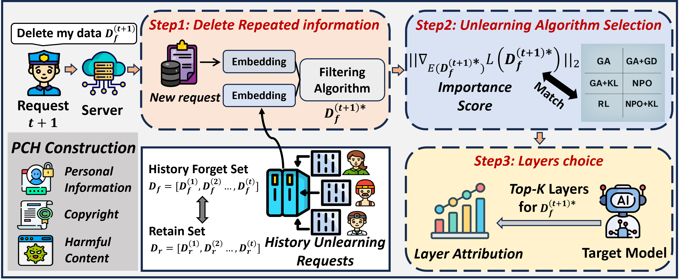

<div align="center">

# FIT to Forget

### Robust Continual Unlearning for Large Language Models

**Code, model checkpoints, and the PCH benchmark for continual LLM unlearning.**

[](https://arxiv.org/abs/2601.21682)
[](https://xiaoyuxu1.github.io/FIT_PCH/)
[](https://huggingface.co/FITPCH)
[](https://huggingface.co/datasets/FITPCH/PCH)
[](https://huggingface.co/datasets/FITPCH/PCH_QA)

Xiaoyu Xu · Minxin Du · Kun Fang · Yaxin Xiao<br>
Zhicong Huang · Cheng Hong · Qingqing Ye · Haibo Hu

The Hong Kong Polytechnic University &nbsp;·&nbsp; Ant Group

[Overview](#overview) · [Models & Data](#models-and-data) · [Quick Start](#quick-start) · [Evaluation](#evaluation) · [Citation](#citation)

</div>

---

## Overview

**FIT** handles sequential deletion requests while preserving retained knowledge. Each request passes through redundancy filtering, importance-aware algorithm selection, and targeted layer attribution.

<p align="center">
  <a href="assets/overview.png">
    
  </a>
  <br>
  <sub><b>The FIT framework.</b> Filter request content, select an unlearning algorithm, and update the relevant layers.</sub>
</p>

### Three decisions for each request

| Component | Role |
| :--- | :--- |
| **F**iltering | Remove redundant content using semantic similarity and loss differences. |
| **I**mportance-aware algorithm selection | Route each filtered request to RLabel, NPO, or NPO+KL using its local sensitivity. |
| **T**argeted layer attribution | Restrict updates to the MLP and attention modules of the selected layers. |

The paper evaluates **300 sequential requests** across **five LLMs up to 14B parameters**, including relearning and quantization recovery tests. The code here includes the FIT pipeline, baseline runners, and PCH evaluation.

## Models and Data

### PCH benchmark

**PCH** contains **600 synthetic records** spanning **Personal information, Copyright, and Harmful content**, paired with **600 question–answer examples**.

| Resource | Contents | Download |
| :--- | :--- | :--- |
| **PCH** | Text records for continual unlearning | [🤗 FITPCH/PCH](https://huggingface.co/datasets/FITPCH/PCH) |
| **PCH QA** | Aligned questions and answers for evaluation | [🤗 FITPCH/PCH_QA](https://huggingface.co/datasets/FITPCH/PCH_QA) |

The runners download both datasets automatically. By default, the first 300 records are shuffled with seed 42 to form the request stream; records not yet requested form the retain set at each stage.

### Released checkpoints

Use a **PCH-finetuned checkpoint** as the starting point for unlearning and the corresponding **retain checkpoint** to compute reference metrics. Browse all releases on [Hugging Face](https://huggingface.co/FITPCH).

| Backbone | Initial checkpoint | Retain reference |
| :--- | :---: | :---: |
| Llama-2-7B-Chat | [🤗 Model](https://huggingface.co/FITPCH/Llama-2-7b-chat-hf_PCH_finetune) | [🤗 Model](https://huggingface.co/FITPCH/Llama-2-7b-chat-hf_PCH_retain) |
| Llama-3-8B | [🤗 Model](https://huggingface.co/FITPCH/Llama-3-8B_PCH_finetune) | [🤗 Model](https://huggingface.co/FITPCH/Llama-3-8B_PCH_retain) |
| Llama-3-8B-Instruct | [🤗 Model](https://huggingface.co/FITPCH/Llama-3-8B-Instruct_PCH_finetune) | [🤗 Model](https://huggingface.co/FITPCH/Llama-3-8B-Instruct_PCH_retain) |
| Yi-6B | [🤗 Model](https://huggingface.co/FITPCH/Yi-6B_PCH_finetune) | [🤗 Model](https://huggingface.co/FITPCH/Yi-6B_PCH_retain) |
| Qwen3-14B | [🤗 Model](https://huggingface.co/FITPCH/Qwen3-14B_PCH_finetune) | [🤗 Model](https://huggingface.co/FITPCH/Qwen3-14B_PCH_retain) |

## Quick Start

### 1. Install

Use **Python 3.10+** and a CUDA-compatible **PyTorch 2.6.0** build.

```bash
git clone https://github.com/XiaoyuXU1/FIT.git
cd FIT

# Install your CUDA-compatible PyTorch build first.
python -m pip install -r requirements.txt
```

### 2. Run FIT

```bash
CUDA_VISIBLE_DEVICES=0 python FIT.py \
  --model FITPCH/Llama-3-8B_PCH_finetune \
  --output Experiment_record/FIT
```

The default run processes **300 requests**, evaluates every **60 requests**, and enables all three FIT components. The model argument accepts either a Hugging Face checkpoint ID or a local checkpoint directory. Initial checkpoint training is separate from these runners.

<details>
<summary><b>Try a short validation run</b></summary>

Process two requests and evaluate on a small subset before launching a full experiment:

```bash
CUDA_VISIBLE_DEVICES=0 python FIT.py \
  --model FITPCH/Llama-3-8B_PCH_finetune \
  --output Experiment_record/FIT_smoke \
  --max_requests 2 --eval_every 2 --eval_limit 2
```

This run is marked as a pilot in its output records.

</details>

### 3. Run a baseline

```bash
CUDA_VISIBLE_DEVICES=0 python Baselines.py \
  --model FITPCH/Llama-3-8B_PCH_finetune \
  --method NPO_KL \
  --output Experiment_record/NPO_KL
```

<details>
<summary><b>Available baselines and CLI names</b></summary>

| Method | CLI value |
| :--- | :--- |
| Gradient Ascent | `GA` |
| GA + Gradient Descent | `GA_GD` |
| GA + KL | `GA_KL` |
| Negative Preference Optimization | `NPO` |
| NPO + KL | `NPO_KL` |
| Random Labeling | `RL` |
| ALKN | `ALKN` |
| O³ | `O3` |
| CURaTE | `CURATE` |

</details>

<details>
<summary><b>Running CURaTE and response-level comparisons</b></summary>

CURaTE requires a separately trained sentence embedder. Supply its checkpoint with `--embedder`:

```bash
CUDA_VISIBLE_DEVICES=0 python Baselines.py \
  --model FITPCH/Llama-3-8B_PCH_finetune \
  --method CURATE \
  --embedder /path/to/trained_CURaTE_embedder \
  --output Experiment_record/CURaTE
```

The runner keeps LLM weights frozen and evaluates the retrieval/refusal path. To evaluate FIT against the same frozen-backbone responses, add this argument to a FIT run:

```bash
--behavioral_baseline Experiment_record/CURaTE/baseline_responses.json
```

</details>

## Evaluation

### F.D. and R.U.

**Forget Degree (F.D.)** and **Retain Utility (R.U.)** measure alignment with retain-model references on the forget and retain sets. Both use a quality score built from Probability, ROUGE-L, and token-level Accuracy:

```text
Quality = 100 × (Probability × ROUGE-L × Accuracy)^(1/3)
F.D. / R.U. = max(0, 1 − |current_quality / reference_quality − 1|)
```

Compute endpoint references once, then pass the resulting file to an experiment:

```bash
python -m Evaluations.reference \
  --initial FITPCH/Llama-3-8B_PCH_finetune \
  --retain FITPCH/Llama-3-8B_PCH_retain \
  --output Experiment_record/reference.json

CUDA_VISIBLE_DEVICES=0 python FIT.py \
  --model FITPCH/Llama-3-8B_PCH_finetune \
  --reference_metrics Experiment_record/reference.json \
  --output Experiment_record/FIT_with_reference
```

Stage references are interpolated between the initial and retain endpoints. Use matching checkpoints, request ordering, and evaluator versions. These scores measure reference alignment, rather than a percentage of knowledge deleted.

### Experiment records

Each run writes to its own output directory:

| File | Contents |
| :--- | :--- |
| `config.json` | Arguments, dataset hash, request order, package versions, and runtime settings |
| `requests.jsonl` | Per-request updates and processing traces |
| `evaluations.json` | Stage-wise quality scores and F.D./R.U. when references are supplied |
| `completed.json` | Timing, memory, budget overshoot, and pilot status |

Existing experiment directories are not silently overwritten. Response-level runs also save generated answers and behavioral metrics.

<details>
<summary><b>Runtime and evaluation settings</b></summary>

- The current `pch-v2` evaluator uses answer-only ROUGE-L and greedy generation with 128 new tokens. NPO+KL uses `KL(reference || current)` for retention regularization. Match this protocol when comparing runs.
- Add `--budget_seconds <seconds>` to impose an online processing budget. GA-family methods do not support this option. Loading and evaluation are outside the online budget; all received requests remain in the evaluation sets.
- Model-specific loading, including Qwen3.5's text backbone, is handled by the shared loader. Optional native kernels are listed in `requirements.txt`; install them after PyTorch with `--no-build-isolation` and a compatible CUDA toolkit. Without them, the loader uses fallback implementations.
- Response-level leakage and refusal measurements are lexical or operational proxies. Timing and memory comparisons depend on the hardware and runtime settings recorded with each run.

</details>

## Repository Layout

```text
FIT.py                       FIT experiment entry point
Baselines.py                 Baseline experiment entry point
Fit/                         Filtering, importance routing, and layer attribution
Unlearning_algorithm/        Unlearning primitives and continual baselines
Evaluations/                 Quality metrics, response evaluation, and references
utils.py                     Shared loading, data ordering, and JSON utilities
assets/                      README figures
requirements.txt             Dependencies
tests/                      Regression checks
```

Run the regression checks with:

```bash
python -m unittest discover -s tests -v
```

## Citation

If you use FIT or PCH in your research, please cite:

```bibtex
@misc{xu2026fitforget,
  title         = {FIT to Forget: Robust Continual Unlearning for Large Language Models},
  author        = {Xiaoyu Xu and Minxin Du and Kun Fang and Yaxin Xiao and Zhicong Huang and Cheng Hong and Qingqing Ye and Haibo Hu},
  year          = {2026},
  eprint        = {2601.21682},
  archivePrefix = {arXiv},
  primaryClass  = {cs.CL},
  url           = {https://arxiv.org/abs/2601.21682}
}
```
